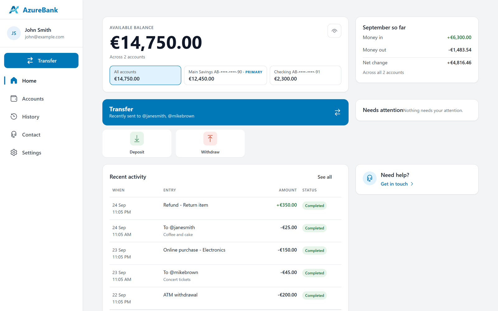
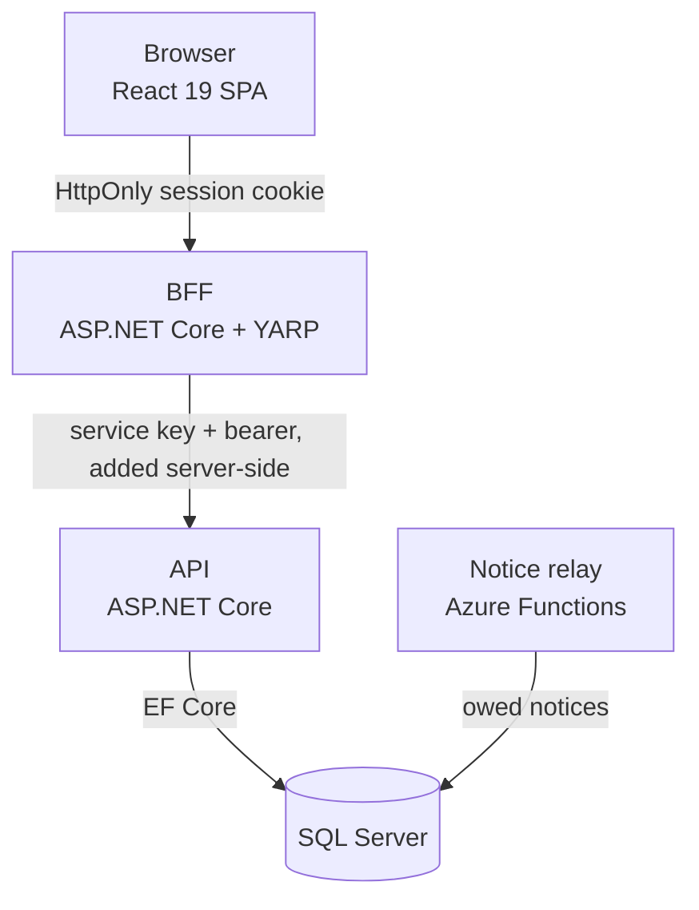

# AzureBank

A personal banking app built as a portfolio project: a .NET 10 API behind an ASP.NET Core BFF, a
React 19 SPA, SQL Server.

I am Vladislav Aleshaev, the project's architect and sole engineer. I designed the system, wrote
part of the code myself and direct the AI coding agents that write the rest. I read the code I
merge and I merge every pull request myself.

[How it works](docs/architecture/overview.md) · [Decisions](docs/adr/README.md) ·
[Security](SECURITY.md) · [Engineering practices](docs/engineering-practices.md)

**[Try the live demo](https://gurgant.github.io/azurebank-v2/)**: in the app, one press of
**Try the demo** gives you a private copy of a bank account with invented money, with no sign-up.
The app sleeps when nobody is using it: the link opens an entry page that starts the server and
shows the wait, about 25 seconds when it was asleep.

<picture>
  <source media="(prefers-color-scheme: dark)" srcset="docs/images/dashboard-dark.png">
  
</picture>

## What it is

Accounts, deposits, withdrawals and transfers. Both halves are real and wired to each other.

The interesting part is not the CRUD. It is everything that has to be true **because it moves
money**: an operation that executes at most once per key across retries, crashes and concurrent
duplicates; a browser that never sees the JWT; a PIN authorisation bound to one payment and spent
once.

## What it demonstrates

- **A payment is applied at most once per key.** Every money move carries an idempotency key. The
  server fingerprints the raw request with a keyed HMAC and claims the key before it acts; the
  client keeps the key after any failure the server might have seen and spends it only on a
  definitive answer. A key is kept for 24 hours: the same request sent again later than that is a
  new payment. Held under 24 concurrent duplicates on a real SQL Server.
  [ADR-0009](docs/adr/0009-idempotency-monetary-operations.md) ·
  [ADR-0022](docs/adr/0022-client-money-mutation-protocol.md) ·
  [the proof](backend/tests/AzureBank.Tests/Integration/IdempotencySqlServerConcurrencyTests.cs)
- **The JWT never reaches the browser.** The BFF keeps it in a server-side session, gives the
  browser an HttpOnly cookie and adds the bearer itself; the API accepts no caller but the BFF.
  [ADR-0001](docs/adr/0001-bff-pattern.md) ·
  [ADR-0038](docs/adr/0038-bff-session-is-the-only-credential.md) ·
  [ADR-0055](docs/adr/0055-the-api-serves-one-client-the-bff.md)
- **One PIN entry authorises one payment.** The PIN becomes a one-shot authorisation bound to the
  account, the amount and, for a transfer, the payee; valid two minutes and spent once. Three wrong
  PINs in a row lock the PIN for 15 minutes.
  [ADR-0042](docs/adr/0042-a-transfer-authorisation-is-bound-and-spent-once.md) ·
  [ADR-0056](docs/adr/0056-a-withdrawal-is-authorised-like-a-transfer.md) ·
  [ADR-0010](docs/adr/0010-pin-attempt-limiting.md)
- **An audit trail that can be checked, with its limits written down.** Security events go to an
  append-only, hash-chained table. A tool in the repository walks the chain; it is run by hand, on
  no schedule, and it does not detect rows cut from the end of the table.
  [ADR-0044](docs/adr/0044-the-audit-trail-is-append-only-and-chained.md)
- **The frontend is held to the API's contract.** The committed OpenAPI contract is what the API
  generates, one contract suite runs against the mock and the real stack, Schemathesis probes
  the running API, and Playwright with axe walks the built app under its production CSP.
  [ADR-0053](docs/adr/0053-the-committed-contract-is-what-the-api-generates.md) ·
  [ADR-0029](docs/adr/0029-contract-conformance-gate.md) ·
  [ADR-0054](docs/adr/0054-the-bff-serves-the-built-spa-under-a-csp-measured-against-it.md)
- **One trace per request.** A request through the BFF is one OpenTelemetry trace down to SQL, and
  every error carries its trace id. By rule a log line carries no name, handle or amount, and an
  e-mail address only masked. Two gaps are written down: trace spans still carry the request path,
  which can hold a handle, and the stack trace of an unhandled fault can echo an e-mail address.
  [ADR-0016](docs/adr/0016-observability-three-pillars.md) ·
  [ADR-0017](docs/adr/0017-pii-redaction-codeql-barrier.md)

## Architecture

The BFF serves the built SPA, holds the session and is the API's only client; the API owns the
money rules. [How AzureBank works](docs/architecture/overview.md) follows one request end to end.

## Stack

| Layer | What it uses |
|---|---|
| Backend | .NET 10, ASP.NET Core, EF Core 10 on SQL Server, YARP, FluentValidation, Serilog, OpenTelemetry, Azure Functions |
| Frontend | React 19, TypeScript, Vite, Fluent UI 9, Redux Toolkit with RTK Query, React Router, react-hook-form with Zod |
| Tests | xUnit, FluentAssertions, NetArchTest; Vitest with MSW; Playwright with axe; Schemathesis; Bruno |
| Delivery | GitHub Actions, CodeQL, AI review on pull requests |

## Try it

- **The live demo**, on Azure — a browser only:
  <https://gurgant.github.io/azurebank-v2/>. One press of **Try the demo** gives you a private copy
  of a bank account with invented money: two accounts (Main Savings €12,450.00 and Checking
  €2,300.00), two months of history and two contacts you can pay. The PIN is `123456`, and the page
  shows it. The copy takes sign-ins for 24 hours; a session open at that moment goes on until it
  ends. It is deleted later, by a job that runs every four hours: a run leaves a copy alone until
  five minutes after its end, and longer while somebody is still signed in to it; from 48 hours
  after its end a run deletes it whoever is signed in. So the deletion comes at a run of the job,
  not at a set time. **Start over** gives you a fresh one. Don't enter real personal data. The
  entry page starts the server and shows the wait: about 25 seconds when it was asleep. The
  journeys to try and the limits you can meet are in [Try the demo](docs/testing/try-the-demo.md).
- **The UI alone**, against a mock that runs in the browser — Node only:
  `cd frontend && npm ci && npm run dev:mock`, then sign in as `demo@azurebank.dev` / `Password1!`,
  PIN `123456`.
- **The whole stack** — .NET 10, Node 24 and SQL Server (LocalDB is enough): the
  [local setup](docs/engineering-practices.md#local-setup). The seeded demo user is
  `john@example.com` / `Test123!`, PIN `123456`.

## Tests and CI

Today every pull request runs all of these, and `main` takes a merge only when the nine required
checks have passed and CodeQL reports no error and no security alert rated high or critical.

| Job | What it checks |
|---|---|
| Backend build + tests | Formatting, a Release build with warnings as errors, that every model change has a migration, the API's and the BFF's test suites |
| Backend concurrency proofs | Idempotency, balances and the audit chain under concurrent requests on a real SQL Server — and that the proofs ran rather than skipped |
| Frontend build | Lint, formatting, the generated types and schemas against the committed contract, the unit tests, the contract suite against the mock, the build |
| Frontend tests (two checks, one per time zone) | The unit tests again under two time zones that disagree about "today" |
| Real-stack layers | The contract suite, the data layer and Playwright with axe, against the real BFF, API and SQL Server |
| Runtime conformance | Schemathesis against the running API, every check, with a real sign-in |
| Contract tests (the check is named Bruno collection) | The Bruno collection, request by request, against the running API |
| Infrastructure | The deployment templates compile and lint clean, the tests of the deployment script and of the PowerShell scripts, a lint of the workflows |

CodeQL analyses the C#, the TypeScript and the workflows on every pull request as well.

Three more jobs run on every pull request and are not among the checks a merge requires: the
documentation site, built with every link checked; the demo's browser suite on the stack a
deployment runs, which restarts two containers of that stack; and a check that no commit message
of the pull request carries a credit line for a second author or a signer, or an at-sign before a
name.

## Read deeper

| Document | What it gives you |
|---|---|
| [How AzureBank works](docs/architecture/overview.md) | One document, complete on its own: how the money guarantee works and why the JWT never reaches the browser |
| [ADR-0009](docs/adr/0009-idempotency-monetary-operations.md) and [ADR-0022](docs/adr/0022-client-money-mutation-protocol.md) | The money protocol, server and client halves: when the client keeps the key and when it spends it |
| [Decisions](docs/adr/README.md) | The decisions and their reasons, with the alternatives rejected and what is left open where a record has them; the index names four to start with |
| [Engineering traps](docs/engineering-traps.md) | The things that fail silently; each one cost real time to find |
| [SECURITY.md](SECURITY.md) | The security posture in one place, including what is not done |
| [Engineering Playbook](docs/engineering-playbook.md) | How I lead the work: what I decide, the path of a change, and what stands between an agent and `main` |
| [Harness engineering](docs/harness-engineering.md) | What I build around the agents: instructions, checks and limits, and one pull request followed from start to finish |

## Status and known limits

- It runs locally and in CI, and since 2026-10-06 it is deployed as a public demo: one small
  replica on Azure Container Apps that sleeps when idle, with Azure SQL Database and no database
  password ([infra/README.md](infra/README.md)).
- The first visit after a quiet spell is slow: the app sleeps when nobody uses it, and the entry
  page starts it and shows the wait. Measured on 2026-10-06, after it had gone to sleep: 27
  seconds until the first page arrived, then 6 seconds for the first sign-in; awake, a sign-in
  took 0.6 seconds. A second cold start, on another day, took 24.6 seconds.
- The demo counts each visitor by their own network address, so
  [the limits](docs/testing/try-the-demo.md#the-limits) that are for one network are that network's
  own: measured on the deployed demo on 2026-10-07
  ([Measured on Azure](infra/README.md#measured-on-azure)). An eleventh copy within 24 hours has
  not been seen refused there.
- axe runs in CI over nine pages and two dialogs and fails on any serious or critical finding
  except colour contrast, which is left to the UI/UX phase; the details are in
  [frontend/README.md](frontend/README.md).
- What the project deliberately does not do yet — anchoring the audit trail outside the database,
  sending the enrolment notice — is in [docs/deferred/](docs/deferred/README.md).

## About this repository

Squash-merged: each pull request lands on `main` as one commit. Changes go through pull requests
gated by CI tests and CodeQL, with AI review, and I merge each one myself; the rules are in
[engineering practices](docs/engineering-practices.md).

The project started in 2025. This repository is its second version, rebuilt and extended from July
2026. The design documents and the earlier history are kept in private repositories.

Released under the [MIT License](LICENSE).
